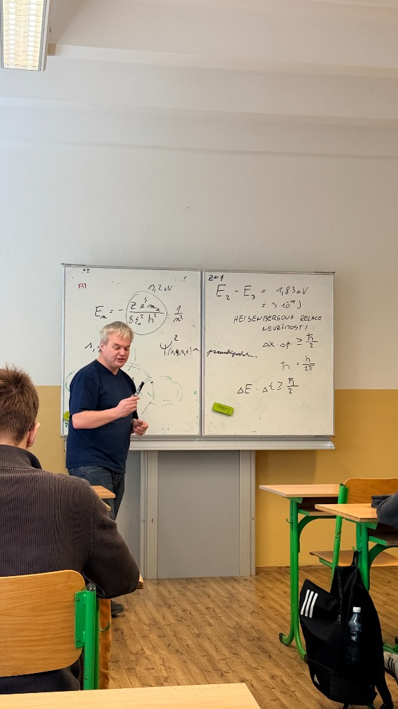
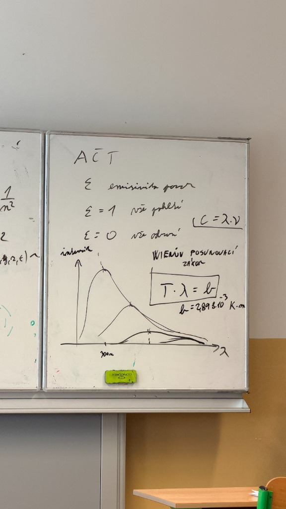

# Kvantová fyzika

## Tahák vzorců

| Vzorec                                                                      | Název                                  | Vypočítáme                                   |
| --------------------------------------------------------------------------- | -------------------------------------- | -------------------------------------------- |
| $E=h\nu=\hbar\omega$                                                        | Planckův–Einsteinův vztah              | energii fotonu                               |
| $c=\lambda\nu$                                                              | Vlnová rovnice                         | vlnovou délku nebo frekvenci                 |
| $\lambda=\frac{h}{p}$                                                       | de Broglieova rovnice                  | vlnovou délku částice                        |
| $L=m_evr=n\hbar$                                                            | Bohrův kvantovací vztah                | moment hybnosti elektronu                    |
| $m_e\frac{v^2}{r}=\frac{Ze^2}{4\pi\varepsilon_0r^2}$                        | Rovnováha Coulombovy a dostředivé síly | rychlost nebo poloměr dráhy                  |
| $r_n=\frac{\varepsilon_0h^2}{\pi m_eZe^2}n^2$                               | Bohrův poloměr dráhy                   | poloměr n-té dráhy                           |
| $E_n=-\frac{m_ee^4Z^2}{8\varepsilon_0^2h^2n^2}$                             | Energie hladin vodíku                  | energii hladiny                              |
| $\Delta E=\lvert E_{n_1}-E_{n_2} \rvert=h\nu=\frac{hc}{\lambda}$            | Přechod mezi energetickými hladinami   | energii, frekvenci nebo vlnovou délku fotonu |
| $\rho=\lvert \Psi \rvert^2$                                                 | Bornova interpretace                   | hustotu pravděpodobnosti                     |
| $\Delta x\,\Delta p_x\ge\frac{\hbar}{2}$                                    | Polohově-hybnostní relace neurčitosti  | mez neurčitosti polohy a hybnosti            |
| $\Delta E\,\Delta t\ge\frac{\hbar}{2}$                                      | Časově-energetická relace neurčitosti  | mez neurčitosti energie a času               |
| $M_{e\lambda}=\frac{2\pi hc^2}{\lambda^5}\frac{1}{e^{hc/(\lambda k_BT)}-1}$ | Planckův zákon                         | spektrální zářivost                          |
| $T\lambda_{\max}=b$                                                         | Wienův posunovací zákon                | teplotu nebo vlnovou délku maxima záření     |
| $M_e=\varepsilon\sigma T^4$                                                 | Stefanův–Boltzmannův zákon             | plošnou hustotu vyzářeného toku              |

## Obsah

- [[#Tahák vzorců|Tahák vzorců]]
- [[#Souhrn konstant a vzorců (Tahák)|Souhrn konstant a vzorců (Tahák)]]
  - [[#🔴 Základní konstanty|🔴 Základní konstanty]]
  - [[#🔵 Klíčové vzorce a vztahy|🔵 Klíčové vzorce a vztahy]]
- [[#1. Základní postuláty a principy kvantové fyziky|1. Základní postuláty a principy kvantové fyziky]]
  - [[#Kontrast světů|Kontrast světů]]
  - [[#Pět základních pilířů mikrosvěta:|Pět základních pilířů mikrosvěta:]]
- [[#2. Bohrův model atomu vodíku|2. Bohrův model atomu vodíku]]
  - [[#Odvození poloměru a energie hladin|Odvození poloměru a energie hladin]]
    - [[#1. Kvantovací podmínka momentu hybnosti:|1. Kvantovací podmínka momentu hybnosti:]]
    - [[#2. Silová rovnováha (Coulombova a dostředivá síla):|2. Silová rovnováha (Coulombova a dostředivá síla):]]
    - [[#3. Celková energie elektronu $E_n$:|3. Celková energie elektronu $E_n$:]]
  - [[#Příklad z tabule: Spektrální přechod $n = 3 \to n = 2$ (Balmerova série, čára $H_\alpha$)|Příklad z tabule: Spektrální přechod $n = 3 \to n = 2$ (Balmerova série, čára $H_\alpha$)]]
- [[#3. Vlnová funkce a atomové orbitaly|3. Vlnová funkce a atomové orbitaly]]
  - [[#Bornova pravděpodobnostní interpretace|Bornova pravděpodobnostní interpretace]]
  - [[#Atomové orbitaly ($s, p, d, f$)|Atomové orbitaly ($s, p, d, f$)]]
- [[#4. Heisenbergovy relace neurčitosti|4. Heisenbergovy relace neurčitosti]]
  - [[#1. Polohově-hybnostní relace|1. Polohově-hybnostní relace]]
  - [[#2. Časově-energetická relace|2. Časově-energetická relace]]
- [[#5. Záření absolutně černého tělesa (AČT)|5. Záření absolutně černého tělesa (AČT)]]
  - [[#Definice a emisivita povrchu $\varepsilon$|Definice a emisivita povrchu $\varepsilon$]]
  - [[#Spektrum záření AČT a Planckův zákon|Spektrum záření AČT a Planckův zákon]]
    - [[#Dva klíčové rysy spektrálních křivek:|Dva klíčové rysy spektrálních křivek:]]
    - [[#Ultrafialová katastrofa vs. Kvantová hypotéza:|Ultrafialová katastrofa vs. Kvantová hypotéza:]]
  - [[#Wienův posunovací zákon|Wienův posunovací zákon]]
    - [[#Příklad z tabule ($\lambda_{\max} = 300\text{ nm}$):|Příklad z tabule ($\lambda_{\max} = 300\text{ nm}$):]]
- [[#Přílohy: Fotodokumentace z výuky|Přílohy: Fotodokumentace z výuky]]
  - [[#Tabule 1: Bohrův model, vlnová funkce a Heisenbergovy relace|Tabule 1: Bohrův model, vlnová funkce a Heisenbergovy relace]]
  - [[#Tabule 2: Absolutně černé těleso, Wienův posunovací zákon a emisivita|Tabule 2: Absolutně černé těleso, Wienův posunovací zákon a emisivita]]

## Souhrn konstant a vzorců (Tahák)

### 🔴 Základní konstanty

| Veličina | Značka | Hodnota | Popis / Význam |
| :--- | :---: | :--- | :--- |
| **Planckova konstanta** | $h$ | $6{,}626 \cdot 10^{-34} \text{ J}\cdot\text{s}$ | Základní kvantová konstanta úměrnosti mezi energií a frekvencí fotonu |
| **Redukovaná Planckova konstanta** | $\hbar = \frac{h}{2\pi}$ | $1{,}055 \cdot 10^{-34} \text{ J}\cdot\text{s}$ | Používá se v relacích neurčitosti a Schrödingerově rovnici (Diracovo $h$) |
| **Rychlost světla ve vakuu** | $c$ | $299\,792\,458 \text{ m/s} \approx 3 \cdot 10^8 \text{ m/s}$ | Fázová rychlost elektromagnetického vlnění ve vakuu |
| **Elementární náboj** | $e$ | $1{,}602 \cdot 10^{-19} \text{ C}$ | Náboj protonu / velikost náboje elektronu ($1 \text{ eV} = 1{,}602 \cdot 10^{-19} \text{ J}$) |
| **Klidová hmotnost elektronu** | $m_e$ | $9{,}109 \cdot 10^{-31} \text{ kg}$ | Zbytková hmotnost elektronu |
| **Permitivita vakua** | $\varepsilon_0$ | $8{,}854 \cdot 10^{-12} \text{ F/m}$ | Konstanta elektrostatického pole v Coulombově zákoně |
| **Wienova konstanta** | $b$ | $2{,}898 \cdot 10^{-3} \text{ m}\cdot\text{K}$ | Konstanta posunu maxima vyzařování černého tělesa |
| **Stefanova-Boltzmannova konstanta** | $\sigma$ | $5{,}670 \cdot 10^{-8} \text{ W}\cdot\text{m}^{-2}\cdot\text{K}^{-4}$ | Konstanta celkové spektrální zářivosti černého tělesa |
| **Rydbergova energie vodíku** | $E_1$ | $-13{,}606 \text{ eV} \approx -2{,}18 \cdot 10^{-18} \text{ J}$ | Vazebná energie elektronu v základním stavu ($n=1, Z=1$) |

---

### 🔵 Klíčové vzorce a vztahy

- **Kvantum energie fotonu:**
  $$ E = h\nu = \hbar \omega $$
  > Energie elektromagnetického pole není vyzařována ani pohlcována spojitě, ale po diskrétních balíčcích (kvantech / fotonech).

- **Základní vlnová rovnice:**
  $$ c = \lambda \cdot \nu $$
  > Vztah mezi rychlostí světla $c$, vlnovou délkou $\lambda$ a frekvencí $\nu$.

- **de Broglieova vlnová délka částice:**
  $$ \lambda = \frac{h}{p} = \frac{h}{mv} $$
  > Každá hmotná částice s hybností $p$ vykazuje vlnové vlastnosti (korpuskulárně-vlnový dualismus).

- **Kvantování momentu hybnosti (Bohr):**
  $$ L = m_e v r = n \hbar = n \frac{h}{2\pi}, \quad n \in \{1, 2, 3, \dots\} $$
  > Stabilní oběžné dráhy elektronu jsou pouze ty, jejichž obvod je celistvým násobkem de Broglieovy vlnové délky elektronu ($2\pi r = n\lambda$).

- **Energetické hladiny vodíkového atomu:**
  $$ E_n = - \frac{m_e e^4 Z^2}{8 \varepsilon_0^2 h^2} \cdot \frac{1}{n^2} = - \frac{13{,}6 \text{ eV}}{n^2} \cdot Z^2 $$
  > Diskrétní energetické spektrum elektronu. Pro vodík platí $Z = 1$. Znaménko mínus indikuje vázaný stav (elektron je držen Coulombickou silou jádra).

- **Energie vyzářeného/pohlceného fotonu při přechodu hladin:**
  $$ \Delta E = |E_{n_1} - E_{n_2}| = h\nu = \frac{hc}{\lambda} $$
  > Foton se vyzáří při deexcitaci z vyšší hladiny $n_2$ na nižší $n_1$.

- **Heisenbergovy relace neurčitosti:**
  $$ \Delta x \cdot \Delta p \ge \frac{\hbar}{2} $$
  $$ \Delta E \cdot \Delta t \ge \frac{\hbar}{2} $$
  > Fundamentální limit současné přesnosti určení konjugovaných veličin (poloha-hybnost, energie-čas).

- **Wienův posunovací zákon (záření AČT):**
  $$ T \cdot \lambda_{\max} = b \implies \lambda_{\max} = \frac{b}{T} $$
  > S rostoucí termodynamickou teplotou $T$ se vlnová délka maxima vyzařování $\lambda_{\max}$ posouvá ke kratším délkám (vyšším energiím).

- **Stefanův-Boltzmannův zákon:**
  $$ M_e = \varepsilon \sigma T^4 $$
  > Celková plošná hustota zářivého toku vyzářená tělesem o teplotě $T$. Pro absolutně černé těleso je $\varepsilon = 1$.

---

## 1. Základní postuláty a principy kvantové fyziky

Klasická newtonovská mechanika a Maxwellova elektrodynamika selhávají při popisu jevů na atomární a subatomární úrovni. Kvantová mechanika zavádí radikálně odlišný matematický a epistemologický aparát.

### Kontrast světů

| Vlastnost | Makrosvět (Klasická fyzika) | Mikrosvět (Kvantová fyzika) |
| :--- | :--- | :--- |
| **Energetická spektra** | Spojitá (kontinuální – libovolná hodnota energie) | Diskrétní (kvantovaná – povoleny pouze určité energetické stavy) |
| **Povaha objektů** | Striktně oddělené částice vs. vlny | Korpuskulárně-vlnový dualismus |
| **Měření a stav** | Deterministický (známe stav $x(t), p(t)$ přesně) | Pravděpodobnostní (stav popsán vlnovou funkcí $\Psi$) |
| **Komutativnost měření** | Nezávisí na pořadí měření veličin | Operátory nekomutují ($\hat{A}\hat{B} \neq \hat{B}\hat{A}$), relace neurčitosti |

### Pět základních pilířů mikrosvěta:
1. **Kvantování fyzikálních veličin:** Veličiny jako energie, moment hybnosti a náboj existují v nedělitelných základních jednotkách (kvantech). Max Planck (1900) zavedl kvantování při řešení vyzařování absolutně černého tělesa ($E = nh\nu$).
2. **Korpuskulárně-vlnový dualismus:** Světlo (původně považované čistě za vlnu) vykazuje částicové vlastnosti (fotoelektrický jev, Comptonův rozptyl – Einstein 1905). Naopak částice s hmotností (elektrony, protony, atomy) vykazují vlnové vlastnosti s vlnovou délkou $\lambda = \frac{h}{p}$ (Louis de Broglie 1924, experimentálně potvrzeno difrakcí elektronů Davissonem a Germerem).
3. **Nekomutativnost měření:** Fyzikální veličiny jsou reprezentovány hermitovskými operátory. Pokud operátory dvou veličin nekomutují ($[\hat{x}, \hat{p}_x] = \hat{x}\hat{p}_x - \hat{p}_x\hat{x} = i\hbar \neq 0$), nelze obě veličiny měřit současně s libovolnou přesností. Samotný proces měření ovlivňuje měřený stav (kolaps vlnové funkce).
4. **Relace neurčitosti:** Heisenbergův princip neurčitosti přímo matematicky plyne z nekomutativnosti operátorů. Neurčitost není chybou měřicího přístroje, ale vnitřní fyzikální vlastností kvantového stavu.
5. **Nedeterminismus a pravděpodobnostní povaha:** Kvantová mechanika nepopisuje deterministické trajektorie částic. Výsledky jednotlivých měření jsou stochastické; přesně předpověditelné je pouze rozdělení pravděpodobností jednotlivých výsledků pomocí vlnové funkce.

---

## 2. Bohrův model atomu vodíku

Niels Bohr (1913) skloubil klasickou mechaniku s kvantovou hypotézou s cílem vyřešit nestabilitu Rutherfordova planetárního modelu (v němž by elektron obíhající po kružnici musel dle Maxwellových rovnic neustále vyzařovat elektromagnetické vlny a během zlomku sekundy spadnout do jádra).

### Odvození poloměru a energie hladin

#### 1. Kvantovací podmínka momentu hybnosti:
Elektron může obíhat pouze po tzv. stacionárních drahách, kde nevyzařuje energii. Podmínka stability stacionární dráhy:
$$ L = m_e v r = n \hbar = \frac{n h}{2\pi} \implies v = \frac{n h}{2\pi m_e r} $$

#### 2. Silová rovnováha (Coulombova a dostředivá síla):
> [!NOTE] Oprava chyby v původních zápiscích
> V dřívějším zápisu rovnosti sil bylo chybně uvedeno: $m_e \frac{v^2}{r} = \frac{1}{4\pi\varepsilon_0} \frac{e^2}{r^2} = \frac{Z e^4 m_e}{8 \varepsilon_0^2 h^2}$. Druhá rovnost je fyzikální i rozměrový nesmysl – levá strana je síla v Newtonech [$\text{N}$], zatímco výraz vpravo je konstanta Rydbergovy energie v Joulech [$\text{J}$].
> 
> Správné odvození postupuje dosazením rychlosti $v$ do silové rovnováhy:

Dostředivá síla je realizována elektrostatickou přitažlivou silou jádra s protonovým číslem $Z$:
$$ F_d = F_e \implies m_e \frac{v^2}{r} = \frac{1}{4\pi\varepsilon_0} \cdot \frac{Z e^2}{r^2} $$
Vynásobením $r$ získáme:
$$ m_e v^2 r = \frac{Z e^2}{4\pi\varepsilon_0} $$
Dosazením $v = \frac{n h}{2\pi m_e r}$:
$$ m_e \left(\frac{n h}{2\pi m_e r}\right)^2 r = \frac{Z e^2}{4\pi\varepsilon_0} \implies \frac{n^2 h^2}{4\pi^2 m_e r} = \frac{Z e^2}{4\pi\varepsilon_0} $$
Odtud poloměr $n$-té stacionární dráhy:
$$ r_n = \frac{\varepsilon_0 h^2}{\pi m_e Z e^2} \cdot n^2 $$
Pro základní stav vodíku ($n=1, Z=1$) dostáváme **Bohrův poloměr**:
$$ r_1 = a_0 \approx 5{,}29177 \cdot 10^{-11} \text{ m} \approx 0{,}053 \text{ nm} $$

#### 3. Celková energie elektronu $E_n$:
Celková energie se skládá z kinetické a potenciální složky:
$$ E_k = \frac{1}{2} m_e v^2 = \frac{Z e^2}{8\pi\varepsilon_0 r_n} $$
$$ E_p = - \frac{Z e^2}{4\pi\varepsilon_0 r_n} $$
$$ E_n = E_k + E_p = - \frac{Z e^2}{8\pi\varepsilon_0 r_n} $$
Dosazením $r_n$ obdržíme kvantovanou energii hladin:
$$ E_n = - \left( \frac{m_e e^4}{8 \varepsilon_0^2 h^2} \right) \cdot \frac{Z^2}{n^2} $$

> [!WARNING] Zápis závislosti na $Z$
> Na tabuli učitel zapsal čitatel jako $Z e^4 m_e$. Pro vodíku podobné ionty ($\text{He}^+, \text{Li}^{2+}$) je správný činitel ve skutečnosti $Z^2$, protože Coulombův potenciál závisí na $Z$ a poloměr $r_n$ má $Z$ ve jmenovateli. Pro atom vodíku je $Z = 1$, takže $Z^2 = Z = 1$, a hodnota v závorce je přesně:
> $$ E_1 = - \frac{m_e e^4}{8 \varepsilon_0^2 h^2} = - 13{,}606 \text{ eV} \approx - 13{,}6 \text{ eV} $$
> Pro obecnou $n$-tou hladinu vodíku ($Z=1$):
> $$ E_n = - \frac{13{,}6 \text{ eV}}{n^2} $$

---

### Příklad z tabule: Spektrální přechod $n = 3 \to n = 2$ (Balmerova série, čára $H_\alpha$)

Zadání z tabule pro $Z = 1$:
1. Výpočet energií hladin:
   $$ E_2 = - \frac{13{,}6 \text{ eV}}{2^2} = - \frac{13{,}6 \text{ eV}}{4} = -3{,}40 \text{ eV} $$
   $$ E_3 = - \frac{13{,}6 \text{ eV}}{3^2} = - \frac{13{,}6 \text{ eV}}{9} \approx -1{,}51 \text{ eV} $$

2. Energie vyzářeného fotonu při deexcitaci:
   $$ \Delta E = |E_2 - E_3| = E_3 - E_2 = -1{,}51 \text{ eV} - (-3{,}40 \text{ eV}) = 1{,}89 \text{ eV} $$
   *(Na tabuli zapsáno jako $E_2 - E_3 = 1{,}89 \text{ eV}$, resp. $1{,}83 \text{ eV}$ jako hrubé zaokrouhlení).*

3. Převod na Jouly:
   $$ \Delta E = 1{,}89 \text{ eV} \cdot 1{,}602 \cdot 10^{-19} \text{ J/eV} \approx 3{,}028 \cdot 10^{-19} \text{ J} \approx 3 \cdot 10^{-19} \text{ J} $$

4. Odpovídající vlnová délka fotonu:
   $$ \lambda = \frac{hc}{\Delta E} = \frac{6{,}626 \cdot 10^{-34} \cdot 3 \cdot 10^8}{3{,}028 \cdot 10^{-19}} \approx 656 \cdot 10^{-9} \text{ m} = 656 \text{ nm} $$
   Jedná se o charakteristickou jasně červenou spektrální čáru vodíku $H_\alpha$ v Balmerově sérii (viditelné spektrum).

---

## 3. Vlnová funkce a atomové orbitaly

Kvantová mechanika (Erwin Schrödinger, 1926) opustila představu elektronu obíhajícího po přesné geometrické dráze a nahradila ji vlnovou funkcí $\Psi(x, y, z, t)$.

### Bornova pravděpodobnostní interpretace
Samotná vlnová funkce $\Psi$ nemá přímý klasický fyzikální význam a je obecně komplexním číslem. Podle **Maxe Borna** (1926) má fyzikální interpretaci čtverec její absolutní hodnoty:
$$ \rho(x, y, z, t) = |\Psi(x, y, z, t)|^2 = \Psi \cdot \Psi^* $$
- $|\Psi|^2$ představuje **hustotu pravděpodobnosti výskytu elektronu** v daném bodě prostoru v čase $t$.
- Pravděpodobnost $\mathrm{d}P$ nalezení elektronu v elementárním objemu $\mathrm{d}V = \mathrm{d}x\,\mathrm{d}y\,\mathrm{d}z$:
  $$ \mathrm{d}P = |\Psi(x, y, z, t)|^2 \, \mathrm{d}V $$
- Podmínka normalizace (elektron se s jistotou $100\,\%$ nachází někde v celém prostoru):
  $$ \int_{-\infty}^{\infty} \int_{-\infty}^{\infty} \int_{-\infty}^{\infty} |\Psi(\vec{r}, t)|^2 \, \mathrm{d}^3\vec{r} = 1 $$

### Atomové orbitaly ($s, p, d, f$)
Orbital je prostorová oblast kolem atomového jádra, ve které se elektron vyskytuje s vysokou pravděpodobností (obvykle definováno jako izoplocha ohraničující $90\,\%$ nebo $95\,\%$ pravděpodobnost výskytu).

Geometrie orbitalů je jednoznačně určena kvantovými čísly:
- **Hlavní kvantové číslo ($n \in \{1, 2, 3, \dots\}$):** Určuje energii hladiny a velikost orbitalu.
- **Vedlejší kvantové číslo ($l \in \{0, 1, \dots, n-1\}$):** Určuje prostorový tvar orbitalu.
  - $l = 0 \to \mathbf{s}$ **orbital:** Kulově symetrický tvar (koule s jádrem ve středu).
  - $l = 1 \to \mathbf{p}$ **orbitaly:** Tři prostorově orientované laloky / prostorové osmičky ($p_x, p_y, p_z$) s nodální rovinou procházející jádrem (nulová hustota pravděpodobnosti v jádře).
  - $l = 2 \to \mathbf{d}$ **orbitaly:** Pět prostorově složitějších útvarů (čtyřlaločné útvary a toroidní prstence).
  - $l = 3 \to \mathbf{f}$ **orbitaly:** Sedm prostorových konfigurací.
- **Magnetické kvantové číslo ($m_l \in \{-l, \dots, 0, \dots, +l\}$):** Určuje prostorovou orientaci orbitalu vůči vnějšímu poli.
- **Spinové kvantové číslo ($m_s \in \{-\frac{1}{2}, +\frac{1}{2}\}$):** Určuje vlastní vnitřní moment hybnosti elektronu (spin).

---

## 4. Heisenbergovy relace neurčitosti

Werner Heisenberg (1927) formuloval vztahy vyjadřující nemožnost současného přesného určení určitých dvojic fyzikálních veličin (tzv. komplementárních či kanonicky sdružených veličin).

### 1. Polohově-hybnostní relace
$$ \Delta x \cdot \Delta p_x \ge \frac{\hbar}{2} $$
kde:
- $\Delta x$ je směrodatná odchylka (neurčitost) v určení polohy podél osy $x$,
- $\Delta p_x$ je směrodatná odchylka v určení složky hybnosti podél osy $x$,
- $\hbar = \frac{h}{2\pi} \approx 1{,}055 \cdot 10^{-34} \text{ J}\cdot\text{s}$ je redukovaná Planckova konstanta.

**Fyzikální důsledek:**
Čím přesněji lokalizujeme polohu částice ($\Delta x \to 0$), tím méně informací máme o její hybnosti a rychlosti ($\Delta p \to \infty$). Tento princip vysvětluje, proč elektron nemůže spadnout do jádra: pokud by byl uvězněn v rozměru jádra ($\Delta x \sim 10^{-15} \text{ m}$), jeho hybnost a kinetická energie by dosáhly tak extrémních hodnot, že by okamžitě z jádra unikl.

### 2. Časově-energetická relace
$$ \Delta E \cdot \Delta t \ge \frac{\hbar}{2} $$
kde:
- $\Delta E$ je neurčitost energie daného kvantového stavu,
- $\Delta t$ je doba existence (střední doba života) tohoto stavu.

**Fyzikální důsledek:**
- **Přirozená šířka spektrálních čar:** Excitovaný stav elektronu v atomu má konečnou dobu života ($\Delta t \sim 10^{-8} \text{ s}$). Z toho plyne nenulová neurčitost jeho energie $\Delta E \ge \frac{\hbar}{2\Delta t}$, což způsobuje, že spektrální čáry nejsou nekonečně ostré linie, ale mají určitou přirozenou šířku.
- **Virtuální částice a vakuum:** Na extrémně krátkých časových intervalech $\Delta t$ může dojít ke zdánlivému narušení zákona zachování energie o velikost $\Delta E \le \frac{\hbar}{2\Delta t}$, což umožňuje existenci virtuálních částic a kvantových fluktuací vakua.

---

## 5. Záření absolutně černého tělesa (AČT)

### Definice a emisivita povrchu $\varepsilon$
**Absolutně černé těleso (AČT)** je ideální fyzikální model tělesa, které dokonale pohlcuje veškeré dopadající elektromagnetické záření všech vlnových délek a žádné neodráží ani nepropouští.

Koeficient pohltivosti / emisivita povrchu $\varepsilon$:
- $\mathbf{\varepsilon = 1}$: **Absolutně černé těleso** – veškeré záření pohlcuje ($100\,\%$ absorpce). Současně je dle Kirchhoffova zákona nejlepším možným zářičem při dané teplotě.
- $\mathbf{\varepsilon = 0}$: **Dokonale odrazivé těleso (bílé těleso / ideální zrcadlo)** – veškeré dopadající záření odráží, nepohlcuje nic.
- $\mathbf{0 < \varepsilon < 1}$: **Reálná (šedá) tělesa** – pohlcují pouze část dopadající energie, emisivita závisí na materiálu, úpravě povrchu a vlnové délce.

---

### Spektrum záření AČT a Planckův zákon

Graf závislosti spektrální hustoty záření $I_\lambda$ (nebo spektrální zářivosti $M_{e\lambda}$) na vlnové délce $\lambda$:

```text
Intenzita I_λ
  ▲
  │        T₁ (nejvyšší teplota, např. T = 9660 K -> λ_max = 300 nm)
  │       /\
  │      /  \
  │     /    \      T₂ (střední teplota)
  │    /  /\  \    /\
  │   /  /  \  \  /  \
  │  /  /    \--*----- \    T₃ (nižší teplota)
  │ /  /       /        \--*---
  │/  /       /                 \_________
  └────────────────────────────────────────► Vlnová délka λ
     300 nm   λ_max(T₂)  λ_max(T₃)
```

#### Dva klíčové rysy spektrálních křivek:
1. **Plocha pod křivkou (celkový vyzářený výkon):** S rostoucí teplotou dramaticky roste plocha pod křivkou podle **Stefanova-Boltzmannova zákona**:
   $$ M_e = \int_0^\infty M_{e\lambda} \, \mathrm{d}\lambda = \sigma T^4 $$
   kde $\sigma \approx 5{,}670 \cdot 10^{-8} \text{ W}\cdot\text{m}^{-2}\cdot\text{K}^{-4}$. Pro reálné těleso s emisivitou $\varepsilon$ je $M_e = \varepsilon \sigma T^4$.
2. **Posun maxima vyzařování:** Se zvyšující se teplotou se maximum spektrální hustoty posouvá ke kratším vlnovým délkám (vykresleno spojnicí vrcholů jednotlivých křivek).

#### Ultrafialová katastrofa vs. Kvantová hypotéza:
Klasická fyzika (Rayleigh-Jeansův zákon založený na ekvipartičním teorému) předpovídala $I_\lambda \propto \frac{T}{\lambda^4}$. Pro $\lambda \to 0$ (oblast UV záření) tato funkce diverguje do nekonečna – tzv. **ultrafialová katastrofa**. 
Max Planck (1900) tento rozpor vyřešil postulátem, že stěny dutiny vyzařují energii po diskrétních kvantech $E = h\nu$, čímž odvodil správný tvar vyzařovacího zákona:
$$ M_{e\lambda}(\lambda, T) = \frac{2\pi h c^2}{\lambda^5} \cdot \frac{1}{e^{\frac{hc}{\lambda k_B T}} - 1} $$

---

### Wienův posunovací zákon

Wienův zákon (Wilhelm Wien, 1893) udává polohu maxima spektrální hustoty vyzařování černého tělesa v závislosti na jeho absolutní teplotě:
$$ T \cdot \lambda_{\max} = b \implies \lambda_{\max} = \frac{b}{T} $$

kde **Wienova konstanta** činí:
$$ b = 2{,}897\,77 \cdot 10^{-3} \text{ m}\cdot\text{K} \approx 2{,}898 \cdot 10^{-3} \text{ m}\cdot\text{K} $$
*(Na tabuli zapsáno jako $b = 2{,}898 \cdot 10^{-3} \text{ K}\cdot\text{m}$).*

#### Příklad z tabule ($\lambda_{\max} = 300\text{ nm}$):
Jaká teplota odpovídá maximu vyzařování na vlnové délce $\lambda_{\max} = 300 \text{ nm}$ (hranice ultrafialového záření, zobrazená na tabuli u křivky)?
$$ T = \frac{b}{\lambda_{\max}} = \frac{2{,}898 \cdot 10^{-3} \text{ m}\cdot\text{K}}{300 \cdot 10^{-9} \text{ m}} = \frac{2{,}898 \cdot 10^{-3}}{3 \cdot 10^{-7}} \approx 9\,660 \text{ K} $$
Takovou teplotu povrchu mají velmi horké hvězdy spektrální třídy A0 (např. Vega).

---

## Přílohy: Fotodokumentace z výuky

### Tabule 1: Bohrův model, vlnová funkce a Heisenbergovy relace


### Tabule 2: Absolutně černé těleso, Wienův posunovací zákon a emisivita

